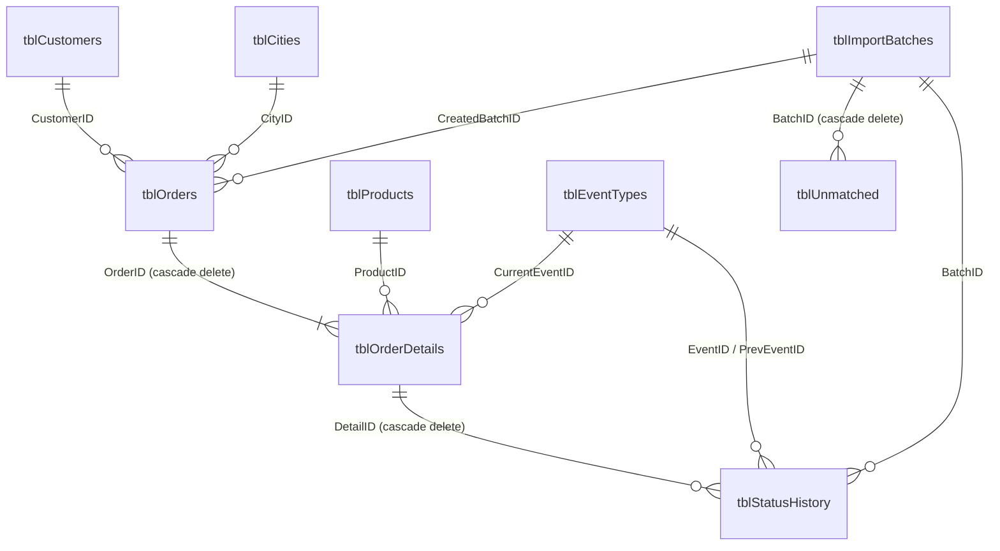

# Inventory Tracker (Microsoft Access + VBA)

An Access front end for shipment inventory. You upload two kinds of Excel file:

| File | Headers (Arabic) | Purpose |
|---|---|---|
| **Inventory list (master)** | `بوليصة الشحن` · `رقم المرجع` · `وصف محتويات الشحنة` · `رقم المرجع الثانوي` | Adds new waybills to the database. Each new one starts as **IN warehouse**. |
| **Status update** | `رقم التتبع` · `مدينة الوجهة` · `آخر حدث` · `اسم المرسل إليه` | Sets the latest event (`آخر حدث`) for every waybill, then works out IN or OUT. |

The two files are linked by the waybill number: `بوليصة الشحن` in the master file is the same as `رقم التتبع` in the status file.

## The IN / OUT rule

| `آخر حدث` (last event) | Location |
|---|---|
| `جاهزة للالتقاط` (ready for pickup) | **IN** warehouse |
| `استلام من العميل` (received from customer) | **IN** warehouse |
| anything else, e.g. `التسليم النهائي` (final delivery) | **OUT** |

The rule lives in `tblEventTypes.IsInWarehouse`, not in code. The first time a new event appears in a status file, it is added automatically as **OUT** and the import summary tells you. To change the rule, open **Event rules** and tick or untick *IN warehouse?*. Every waybill on that event is recalculated straight away.

Event names are matched loosely. Extra spaces, invisible RTL marks, `آ/أ/إ/ا`, `ى/ي` and `ة/ه` are all treated as the same, so small typing differences in the carrier's file do not create duplicate events.

## Build the database (one time)

**Option A: one click.** On Windows with Access installed, double-click `access\build.bat`. It creates `InventoryTracker.accdb` in the same folder, imports the modules and builds everything. To put the database somewhere else, run `build.bat "D:\Data\MyInventory.accdb"` from a command prompt. The `.bat` file runs `build.vbs`, so keep both files together with the `vba` folder.

**Option B: by hand.**
1. In Access, create a new **Blank database**.
2. Press `Alt+F11`, then **File → Import File…** and import every file in `access\vba\*.bas`.
3. Check **Tools → References** includes *Microsoft Office xx.0 Access database engine Object Library* (it does by default).
4. Choose **Debug → Compile**, then type this in the Immediate window (`Ctrl+G`):
   ```
   BuildInventoryDatabase
   ```
5. Close and reopen the file. It opens on the dashboard.

Running `BuildInventoryDatabase` again rebuilds the queries and forms without touching your data. `BuildInventoryDatabase True` drops every table and starts empty.

Excel must be installed, because the importer reads workbooks through Excel automation. This handles any header row in the first 15 rows, any sheet order, `.xlsx`, `.xlsm` and `.xls`, and stops numbers like `71204-1` from being treated as dates.

## Daily workflow

1. **Dashboard → Upload Excel → Browse… → Import.** Leave *File type* on **Auto**: a file with an `آخر حدث` column is treated as a status update, anything else as an inventory list.
2. Read the summary. It shows rows read, duplicates, new waybills or status changes, waybills not found in the database, and how many items in *this file* are IN and OUT. It ends with the new inventory totals.
3. Use **IN warehouse** or **OUT of warehouse** to see the lists, or **Export IN list / Export OUT list** to save them to Excel.
4. Check **Unmatched** for waybills the carrier reported that are not in your inventory list.

A failed import is rolled back completely, so the database is never left half-updated.

## Schema



| Table | Key | What it holds | Excel source |
|---|---|---|---|
| `tblCustomers` | `CustomerID`, unique `CustomerName` | Consignees. `CustomerCode` is parsed from the end of the name (`… - M174562`). | `اسم المرسل إليه` |
| `tblCities` | `CityID`, unique `CityName` | Destination cities | `مدينة الوجهة` |
| `tblProducts` | `ProductID`, unique `ProductDescription` | Shipment contents. `ProductCode` is the part after the last `\` (`G9-L1`). | `وصف محتويات الشحنة` |
| `tblEventTypes` | `EventID`, unique `EventKey` | Carrier events plus the **IsInWarehouse** rule | `آخر حدث` |
| `tblOrders` | `OrderID`, unique `ReferenceNo` | One row per reference number | `رقم المرجع`, `رقم المرجع الثانوي` |
| `tblOrderDetails` | `DetailID`, unique `Waybill` | **One row per waybill (the inventory item):** current event, `InWarehouse`, quantity | `بوليصة الشحن` / `رقم التتبع` |
| `tblStatusHistory` | `HistoryID` | Every change of event: from, to, IN/OUT before and after, and which file it came from | n/a |
| `tblImportBatches` | `BatchID` | One row per uploaded file, with its counts | n/a |
| `tblUnmatched` | `UnmatchedID` | Status rows whose waybill is not in the database | n/a |
| `tblStage_Master`, `tblStage_Status` | `StageID` | Cleaned rows of the last uploaded file | whole file |
| `tblErrorLog` | `ErrorID` | Every trapped VBA error | n/a |

The full DDL is in [`sql/01_create_tables.sql`](sql/01_create_tables.sql).

## Queries

All queries are listed in [`sql/02_queries.sql`](sql/02_queries.sql).

| Group | Queries |
|---|---|
| Import, inventory list | `qryImp_ClearStageMaster` → `qryImp_AppendProducts` → `qryImp_AppendOrders` → `qryImp_UpdateOrdersSecondaryRef` → `qryImp_AppendDetails` |
| Import, status update | `qryImp_ClearStageStatus` → `qryImp_AppendEventTypes` → `qryImp_AppendCities` → `qryImp_AppendCustomers` → `qryImp_AppendUnmatched` → `qryImp_AppendHistory` → `qryImp_UpdateDetailsStatus` → `qryImp_UpdateOrdersCustomer` → `qryImp_UpdateOrdersCity` |
| Maintenance | `qryAct_RecalcInWarehouse` (after a rule change), `qryAct_PurgeOldUnmatched` (deletes rows older than 90 days) |
| Lists for forms | `qryShipmentsList`, `qryShipmentHistory`, `qryEventTypesList`, `qryImportBatchesList` |
| Reports | `qryRpt_InventorySummary`, `qryRpt_ByEvent`, `qryRpt_ByProduct`, `qryRpt_ByCity`, `qryRpt_InWarehouse`, `qryRpt_OutOfWarehouse`, `qryRpt_LastStatusBatch`, `qryRpt_LastStatusFileSplit`, `qryRpt_LastStatusChanges`, `qryRpt_UnmatchedAll`, `qryRpt_UnmatchedLastBatch`, `qryRpt_NeverUpdated` |

## VBA modules

| Module | Responsibility |
|---|---|
| `modConfig` | App constants, Arabic header aliases, seed events. Arabic is stored as `\uXXXX` escapes so the code works on Windows PCs whose system locale is not Arabic. |
| `modErrorHandler` | `LogError` writes to `tblErrorLog` and shows the message. Also `ShowInfo`, `ShowWarning`, `Confirm`. |
| `modUtils` | Text cleaning (`NormText`, `NormKey`, `NormWaybill`), code parsing, file dialogs, Excel reading and header detection |
| `modImport` | `ImportExcelFile`: validate, read, detect type, stage, then run the action queries in one transaction and write the summary |
| `modNavigation` | Dashboard KPIs, opening and closing forms, button handlers, search and filter, exports |
| `modBuildDatabase` | Creates the tables, seed data, queries, forms and startup options |

Forms and the dashboard are described in [`docs/forms-layout.md`](docs/forms-layout.md).

## Test with the sample files

`samples/` contains a small file of each kind. Regenerate them with `python access/tools/make_samples.py`.

1. Import `master_inventory_sample.xlsx`. You should get **6 new waybills**, IN 6, OUT 0.
2. Import `status_update_sample.xlsx`. You should get:
   - 7 rows read and 1 duplicate (the last row is kept)
   - **5 status changed**
   - **1 not found** (`EBUXSL2079999999`)
   - 1 new event type (`قيد التوصيل`, added as OUT)
   - This file: IN 2, OUT 3
   - Inventory now: **IN 3** (two IN events, plus `EBUXSL2079500004`, which was not in the status file) and **OUT 3**
3. Open **Event rules**, tick `قيد التوصيل` as IN, and save the row. The dashboard should change to IN 4, OUT 2.

## Editing the SQL

The SQL is defined in `vba/modBuildDatabase.bas`. After changing it, regenerate the reference files:

```
python access/tools/extract_sql.py
```
