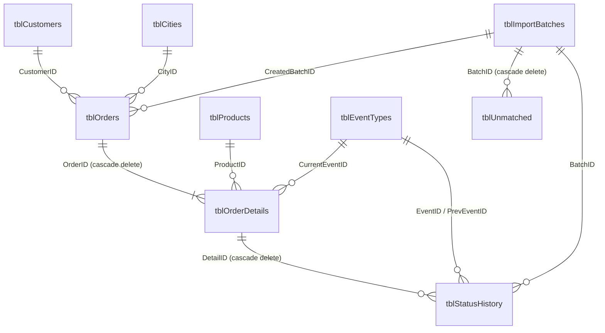

# Inventory Tracker (Microsoft Access + VBA)

An Access front end for shipment inventory. You upload two kinds of Excel file:

| File | Headers (Arabic) | Purpose |
|---|---|---|
| **Inventory list (master)** | `بوليصة الشحن` · `رقم المرجع` · `وصف محتويات الشحنة` · `رقم المرجع الثانوي` | Adds new waybills to the database. Each new one starts as **IN warehouse**. |
| **Status update** | `رقم التتبع` · `مدينة الوجهة` · `آخر حدث` · `اسم المرسل إليه` | Sets the latest event (`آخر حدث`) for every waybill, then works out IN or OUT. |

The two files are linked by the waybill number: `بوليصة الشحن` in the master file is the same as `رقم التتبع` in the status file.

## The IN / OUT rule

| `آخر حدث` (last event) | Location |
|---|---|
| `جاهزة للالتقاط` (ready for pickup) | **IN** warehouse |
| `استلام من العميل` (received from customer) | **IN** warehouse |
| **anything else**, e.g. `التسليم النهائي` (final delivery), `قيد التوصيل`, or any event the carrier adds later | **OUT** |

This rule is fixed. The two IN events are defined in `modConfig.SeedEvents`. Every status import re-applies the rule to `tblEventTypes` and to every waybill, so a manual edit to the table cannot make another event count as IN. A new event that appears in a status file is added automatically as **OUT**, and the import summary tells you.

A waybill that has been loaded from the inventory list but has not yet appeared in any status file has no `آخر حدث` yet. It counts as **IN**, because it is in your inventory list.

Event names are matched loosely. Extra spaces, invisible RTL marks, `آ/أ/إ/ا`, `ى/ي` and `ة/ه` are all treated as the same, so small typing differences in the carrier's file do not create duplicate events.

## Build the database (one time)

**Option A: one click.** On Windows with Access installed, double-click `access\build.bat`. It creates `InventoryTracker.accdb` in the same folder, imports the modules and builds everything. To put the database somewhere else, run `build.bat "D:\Data\MyInventory.accdb"` from a command prompt. The `.bat` file runs `build.vbs`, so keep both files together with the `vba` folder.

**Option B: by hand.**
1. In Access, create a new **Blank database**.
2. Press `Alt+F11`, then **File → Import File…** and import every file in `access\vba\*.bas`.
3. Check **Tools → References** includes *Microsoft Office xx.0 Access database engine Object Library* (it does by default).
4. Choose **Debug → Compile**, then type this in the Immediate window (`Ctrl+G`):
   ```
   BuildInventoryDatabase
   ```
5. Close and reopen the file. It opens on the dashboard.

Running `BuildInventoryDatabase` again rebuilds the queries and forms without touching your data. `BuildInventoryDatabase True` drops every table and starts empty.

Excel must be installed, because the importer reads workbooks through Excel automation. This handles any header row in the first 15 rows, any sheet order, `.xlsx`, `.xlsm` and `.xls`, and stops numbers like `71204-1` from being treated as dates.

## Grades, quantity and loss

The contents column (`وصف محتويات الشحنة`) ends in a grade code after a separator, such as `نقطة توزيع المجاردة \\ G1`, `… / G1` or `… // G1-L4`. Any of `\`, `/` or `//` works. The grades are **G1–G9 and G11–G13**; there is no G10. They are listed in `modConfig.GRADE_LIST` and in the `tblGrades` table. Any other code, including G10, counts as *no grade* and is reported separately instead of being added to a grade.

| Code in the row | Meaning |
|---|---|
| `G1` | **1 item** of grade G1. Each such row (waybill) adds 1 to G1's quantity. |
| `G1-L4` | **Only a loss:** 4 items lost for grade G1. It adds 4 to G1's loss and **nothing** to the quantity. |

Totals are kept per consignee (`اسم المرسل إليه`, from the status file). For example, 5 rows of `G1` and 1 row of `G1-L4` for the same consignee give **G1 quantity 5, loss 4**.

If the contents have no code, the grade is taken from `رقم المرجع الثانوي` instead (for example `ASR-SEP30-G9` gives G9). A waybill that hasn't appeared in a status file yet is listed as *(no consignee yet)*.

**On every master upload**, the import summary adds up the whole file by grade:

```
Totals in this file by grade:
  Grade        Qty     Loss
  G1             5        4
  G9             2        1
  TOTAL          7        5
```

**Export grade totals** on the upload screen saves the same table to Excel (query `qryRpt_LastMasterFileByGrade`).

### Grade stock form

**Grade stock** opens automatically after every upload, and from the dashboard. It shows one row per grade and a TOTAL row. **G2 and G2-L are kept separate:** each has its own Total, IN, OUT and Remaining, and neither is subtracted from the other.

| Columns | G side: plain `G2` rows | L side: `G2-L<k>` rows |
|---|---|---|
| Total | Number of `G2` rows (1 each) | Sum of the L numbers (`G2-L4` adds 4) |
| IN | Total of those rows whose last event is `جاهزة للالتقاط` or `استلام من العميل`, or which have no status yet | Same rule, applied to the L rows |
| OUT | Total of those rows with any other last event | Same rule, applied to the L rows |
| **Remaining** | Total − OUT | Total − OUT |

For example, take 10 rows of `G2` with 4 OUT, and 2 rows of `G2-L4` where one is IN and one is OUT:

| Grade | G Total | G IN | G OUT | G Remaining | L Total | L IN | L OUT | L Remaining |
|---|---|---|---|---|---|---|---|---|
| G2 | 10 | 6 | 4 | 6 | 8 | 4 | 4 | 4 |

The footer also counts waybills without a valid grade. **Export to Excel** saves the table (`qryRpt_GradeStock`).

Where to see the totals for the whole database:
- The **Grade stock** form, and the same table on the dashboard.
- The **Consignee x grade** form, which shows each consignee and grade with Qty, Loss, Qty IN and Qty OUT.
- **Export to Excel** on that form, which saves one workbook with three sheets: the detail list, a quantity table (one column per grade, G1–G9 and G11–G13) and a loss table in the same layout.

Re-importing the inventory file updates the grade and loss of waybills that are already in the database.

## Daily workflow

1. **Dashboard → Upload Excel → Browse… → Import.** Leave *File type* on **Auto**: a file with an `آخر حدث` column is treated as a status update, anything else as an inventory list.
2. Read the summary. It shows rows read, duplicates, new waybills or status changes, waybills not found in the database, and how many items in *this file* are IN and OUT. It ends with the new inventory totals.
3. Use **IN warehouse** or **OUT of warehouse** to see the lists, or **Export IN list / Export OUT list** to save them to Excel.
4. Check **Unmatched** for waybills the carrier reported that are not in your inventory list.

A failed import is rolled back completely, so the database is never left half-updated.

## Schema



| Table | Key | What it holds | Excel source |
|---|---|---|---|
| `tblCustomers` | `CustomerID`, unique `CustomerName` | Consignees. `CustomerCode` is parsed from the end of the name (`… - M174562`). | `اسم المرسل إليه` |
| `tblGrades` | `GradeCode` | The valid grades (G1–G9, G11–G13) in display order | n/a |
| `tblCities` | `CityID`, unique `CityName` | Destination cities | `مدينة الوجهة` |
| `tblProducts` | `ProductID`, unique `ProductDescription` | Shipment contents. `ProductCode` is the part after the last `\` (`G9-L1`). | `وصف محتويات الشحنة` |
| `tblEventTypes` | `EventID`, unique `EventKey` | Carrier events. `IsInWarehouse` is True only for the two IN events. | `آخر حدث` |
| `tblOrders` | `OrderID`, unique `ReferenceNo` | One row per reference number | `رقم المرجع`, `رقم المرجع الثانوي` |
| `tblOrderDetails` | `DetailID`, unique `Waybill` | **One row per waybill (the inventory item):** current event, `InWarehouse`, quantity, `GradeCode` (references `tblGrades`), `LossQty` (the n in `-Ln`) | `بوليصة الشحن` / `رقم التتبع` |
| `tblStatusHistory` | `HistoryID` | Every change of event: from, to, IN/OUT before and after, and which file it came from | n/a |
| `tblImportBatches` | `BatchID` | One row per uploaded file, with its counts | n/a |
| `tblUnmatched` | `UnmatchedID` | Status rows whose waybill is not in the database | n/a |
| `tblStage_Master`, `tblStage_Status` | `StageID` | Cleaned rows of the last uploaded file | whole file |
| `tblErrorLog` | `ErrorID` | Every trapped VBA error | n/a |

The full DDL is in [`sql/01_create_tables.sql`](sql/01_create_tables.sql).

## Queries

All queries are listed in [`sql/02_queries.sql`](sql/02_queries.sql).

| Group | Queries |
|---|---|
| Import, inventory list | `qryImp_ClearStageMaster` → `qryImp_AppendProducts` → `qryImp_AppendOrders` → `qryImp_UpdateOrdersSecondaryRef` → `qryImp_AppendDetails` → `qryImp_UpdateDetailsGrade` |
| Import, status update | `qryImp_ClearStageStatus` → `qryImp_AppendEventTypes` → `qryImp_AppendCities` → `qryImp_AppendCustomers` → `qryImp_AppendUnmatched` → `qryImp_AppendHistory` → `qryImp_UpdateDetailsStatus` → `qryImp_UpdateOrdersCustomer` → `qryImp_UpdateOrdersCity` |
| Maintenance | `qryAct_RecalcInWarehouse` (re-applies the rule to every waybill; runs on each status import), `qryAct_PurgeOldUnmatched` (deletes rows older than 90 days) |
| Lists for forms | `qryShipmentsList`, `qryShipmentHistory`, `qryEventTypesList`, `qryImportBatchesList` |
| Reports | `qryRpt_InventorySummary`, `qryRpt_ByEvent`, `qryGradeTotals` → `qryRpt_GradeStock`, `qryRpt_LastMasterFileByGrade`, `qryRpt_ByConsigneeGrade`, `qryRpt_ConsigneeGradeQty` (crosstab), `qryRpt_ConsigneeGradeLoss` (crosstab), `qryRpt_ByProduct`, `qryRpt_ByCity`, `qryRpt_InWarehouse`, `qryRpt_OutOfWarehouse`, `qryRpt_LastStatusBatch`, `qryRpt_LastStatusFileSplit`, `qryRpt_LastStatusChanges`, `qryRpt_UnmatchedAll`, `qryRpt_UnmatchedLastBatch`, `qryRpt_NeverUpdated` |

## VBA modules

| Module | Responsibility |
|---|---|
| `modConfig` | App constants, Arabic header aliases, seed events. Arabic is stored as `\uXXXX` escapes so the code works on Windows PCs whose system locale is not Arabic. |
| `modErrorHandler` | `LogError` writes to `tblErrorLog` and shows the message. Also `ShowInfo`, `ShowWarning`, `Confirm`. |
| `modUtils` | Text cleaning (`NormText`, `NormKey`, `NormWaybill`), code parsing, file dialogs, Excel reading and header detection |
| `modImport` | `ImportExcelFile`: validate, read, detect type, stage, then run the action queries in one transaction and write the summary |
| `modNavigation` | Dashboard KPIs, opening and closing forms, button handlers, search and filter, exports |
| `modBuildDatabase` | Creates the tables, seed data, queries, forms and startup options |

Forms and the dashboard are described in [`docs/forms-layout.md`](docs/forms-layout.md).

## Test with the sample files

`samples/` contains a small file of each kind. Regenerate them with `python access/tools/make_samples.py`.

1. Import `master_inventory_sample.xlsx`. You should get **9 new waybills**, IN 9, OUT 0, and the grade totals **G1: Qty 5, Loss 4** and **G9: Qty 2, Loss 1**. The sample uses the `\\`, `//` and `/` separators.
2. Import `status_update_sample.xlsx`. You should get:
   - 10 rows read and 1 duplicate (the last row is kept)
   - **8 status changed**
   - **1 not found** (`EBUXSL2079999999`)
   - 1 new event type (`قيد التوصيل`, added as OUT)
   - This file: IN 3, OUT 5
   - Inventory now: **IN 4** (three IN events, plus `EBUXSL2079700003`, which was not in the status file) and **OUT 5**
3. Open **Consignee x grade**. You should see:

   | Consignee | Grade | Qty | Loss | Qty IN | Qty OUT |
   |---|---|---|---|---|---|
   | (no consignee yet) | G9 | 1 | 0 | 1 | 0 |
   | ثانوية منار العلم الأهلية - مسارات - M174562 | G1 | 5 | 4 | 2 | 3 |
   | متوسطة حائل - مسارات - M174100 | G9 | 1 | 1 | 1 | 0 |
4. **Grade stock** opens after each upload. Grades with no rows show 0.

   | After | Grade | G Total | G IN | G OUT | G Remaining | L Total | L IN | L OUT | L Remaining |
   |---|---|---|---|---|---|---|---|---|---|
   | master only | G1 | 5 | 5 | 0 | 5 | 4 | 4 | 0 | 4 |
   | master only | G9 | 2 | 2 | 0 | 2 | 1 | 1 | 0 | 1 |
   | + status | G1 | 5 | 2 | 3 | 2 | 4 | 0 | 4 | 0 |
   | + status | G9 | 2 | 2 | 0 | 2 | 1 | 0 | 1 | 0 |

## Editing the SQL

The SQL is defined in `vba/modBuildDatabase.bas`. After changing it, regenerate the reference files:

```
python access/tools/extract_sql.py
```
